<div align="center">
  
</div>

<div align="center">
  
</div>


<h1 align="center">
  <span style="
    color: #ffffff;
    text-shadow:
      0 0 5px #ffee00,
      0 0 10px #ffee00,
      0 0 20px #39ff14,
      0 0 35px #39ff14,
      0 0 45px #ff3030;
  ">
    P E N G U 1 N
  </span>
</h1>

### For that which I do I allow not: for what I would, that do I not; but what I hate, that do I.

<div align="center">

<a href="https://github.com/Hillaryns">
  
</a>

<br/>

[](https://github.com/Hillaryns)
[](https://github.com/Hillaryns)

</div>

<div align="center">
  
</div>

## `whoami`

```python
class Pengu1n:
    def __init__(self):
        self.role = "Student"
        self.interests = [
            "Artificial Intelligence",
            "Full-Stack Development",
            "Cybersecurity",
            "Linux & Operating Systems",
        ]
        self.languages = ["Python", "JavaScript", "C"]
        self.current_focus = "Building useful things"

    def motto(self):
        return "NEIN, NURRRR, SLWWPY"
```

<div align="center">
  
</div>

## 🌐 Connect With Me

<div align="center">

[](https://www.instagram.com/pengu_1n_1/)
[](https://www.facebook.com/KSPengu1n/)
[](https://www.chess.com/member/meowwww_wwwwwwwwwww)
[](https://github.com/hillaryns)

</div>

## `tech_stack`

<div align="center">

**Languages**


**Frameworks & Backend**


**Tools & Environment**


</div>

<div align="center">
  
</div>


## `featured_projects`

| Project | Description | Stack |
|---|---|---|
| [PENGU1N](https://github.com/Hillaryns/PENGU1N) | Academia–industry skill mapping and placement readiness platform | React, Node.js, MongoDB |
| [LAN TYPE](https://github.com/Hillaryns/lan-type) | Multiplayer typing competition over a local network | React, Express, Socket.IO |

## `github_stats`

<div align="center">


</div>

## 👾 `contribution_graph`

<div align="center">

<picture>
  <source media="(prefers-color-scheme: dark)" srcset="https://raw.githubusercontent.com/hillaryns/hillaryns/output/pacman-contribution-graph-dark.svg">
  
</picture>

</div>

## `currently`

- Exploring AI and machine learning.
- Building full-stack applications.
- Experimenting with Linux and system development.
- Learning cybersecurity and bug bounty methodology.

---

<div align="center">

*IT IS WHAT IT IS*

</div>
